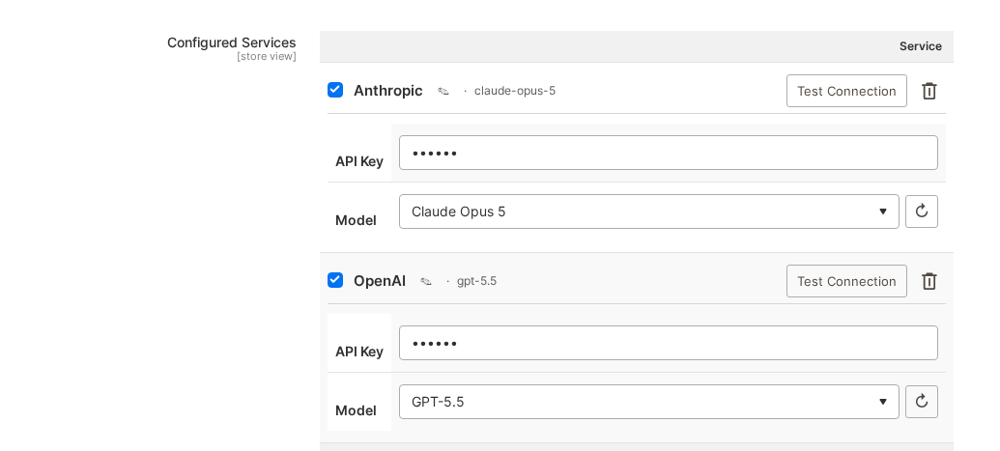
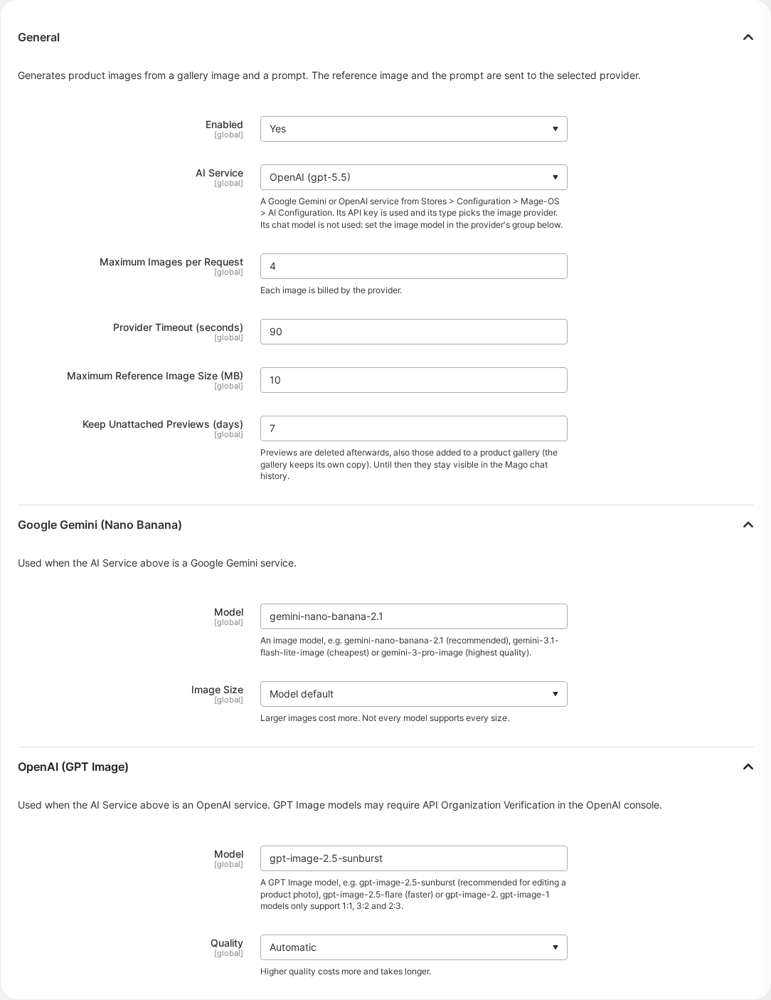
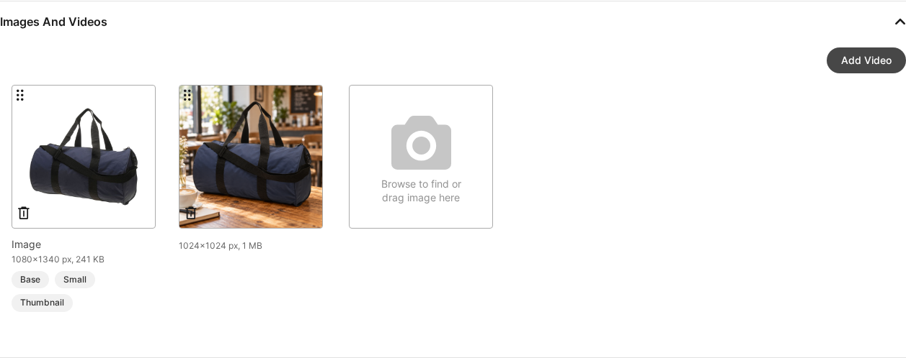

# Orangecat_MagoAiImage

Mago Assistant add-on that creates product images with AI from one of the product's gallery
images and a prompt ("a person walking through the city wearing this jacket"). Images are created
as **previews** and only reach the product gallery when someone attaches them.

One module holds everything: the generation core, the Google Gemini and OpenAI providers, the
`dummy` provider (developer mode only) and the Mago tools. The chat model (e.g. Kimi) only
orchestrates; the image is made by the image provider of the selected AI service.

## Compatibility

| | Supported |
|---|---|
| Magento Open Source | 2.4.8 and later |
| Mage-OS | Releases built on Magento 2.4.8 or later |
| PHP | 8.2 to 8.5 |
| Mago | `mago-assistant/magento2-mago` 1.1 or later |
| Mage-OS AI Base | `mage-os/module-ai-base` 1.1 or later |
| Storefront | Admin only. Attached images are ordinary gallery images, so they show in any theme (Luma, Hyvä) and headless frontend. |

CI tests the currently supported Mage-OS versions. Adobe Commerce is not tested.

## Install

```bash
composer require orangecat/module-mago-ai-image
bin/magento module:enable Orangecat_MagoAiImage
bin/magento setup:upgrade
```

## Getting started

1. Add the API key once, in Mage-OS AI Base: `Stores > Configuration > Mage-OS > AI Configuration`,
   add a **Google Gemini** or **OpenAI** service with its API key and save. The key never goes into
   this module's settings.

   
2. Open `Stores > Configuration > Mago Assistant > Image Generation`, set **Enabled** to Yes, pick
   that service under **AI Service** and save.

   
3. Make sure the admin role has `Catalog > Inventory > Products > Image Generation` (with
   *Generate Previews* and *Add to Product Gallery*) and access to products, and that the image
   tools are allowed for the user under `Stores > Admin Assistant > Skills & Permissions`.
4. Open the Mago chat panel and ask, for example: *Generate an image for WJ12 of a person walking
   through the city wearing this jacket, 3:4 format*. Confirm the card: every image is billed by
   the provider. The previews appear in the chat.
5. Ask *Add the first one as the base image*. After confirming, the image is in the product's
   gallery under `Catalog > Products > WJ12 > Images and Videos`.

   

`bin/magento mago:ai-image:providers` shows the selected service, which provider serves it and
whether generation can run.

## Configuration

All settings are under `Stores > Configuration > Mago Assistant > Image Generation`
(`mago_ai_image/*`) and are **default scope only**: the Mago tools, the cleanup cron and the CLI
run without a store, so a website value would never be read.

### General

| Setting | Default | What it does |
|---|---|---|
| Enabled | No | Shows the image tools to Mago. While No, Mago doesn't offer them and the CLI refuses to generate. |
| AI Service | (none) | A Google Gemini or OpenAI service from Mage-OS AI Configuration. Its API key is used and its type picks the provider: a Google row uses Gemini, an OpenAI row uses OpenAI. Its chat model is not used. "OpenAI compatible" rows (such as Kimi) are not offered: they have no image API. |
| Maximum Images per Request | 4 | Upper limit for one generation (1 to 10). The provider's own limit applies too. Each image is billed. |
| Provider Timeout (seconds) | 90 | Per call to the provider (10 to 600). Gemini makes one call per image, so a request for several images can take several times this long. |
| Maximum Reference Image Size (MB) | 10 | A larger gallery image is refused as reference instead of being sent. |
| Keep Unattached Previews (days) | 7 | After this, the daily cleanup discards previews nobody attached and removes the preview copy of attached ones (the gallery keeps its own copy). Until then they stay visible in the Mago chat history. |

### Google Gemini (Nano Banana)

Used when the AI Service is a Google Gemini service.

| Setting | Default | What it does |
|---|---|---|
| Model | `gemini-nano-banana-2.1` | The image model. `gemini-3.1-flash-lite-image` is the cheapest, `gemini-3-pro-image` the highest quality. Any image model name works, including ones newer than this module. |
| Image Size | Model default | 1K, 2K or 4K. Larger images cost more; not every model supports every size. |

`mago_ai_image/gemini/base_url` (`https://generativelanguage.googleapis.com`, without the API
version) can be changed in `config.xml` or with `bin/magento config:set`, for example to route
through a proxy. It must be an http or https URL.

### OpenAI (GPT Image)

Used when the AI Service is an OpenAI service.

| Setting | Default | What it does |
|---|---|---|
| Model | `gpt-image-2.5-sunburst` | The GPT Image model. `gpt-image-2.5-flare` is faster; `gpt-image-1` models only support 1:1, 3:2 and 2:3. GPT Image models may require API Organization Verification in the OpenAI console. |
| Quality | Model default | Low, medium or high. Higher quality costs more and takes longer. |

The reference image and the prompt are sent to the provider of the selected service.

## Providers

Gemini and OpenAI go through the Symfony AI bridges (`symfony/ai-gemini-platform`,
`symfony/ai-open-ai-platform`, `^0.15` like MageOS_AiBase 1.1), built per request by
`Model\Platform\PlatformFactory` with the configured timeout and no redirects. The model is built
from the configured name instead of the bridge catalog, so newer models work without a bridge
release. `Model\Platform\ResponseReader` reads the HTTP status and body before the bridge
converts the result: the bridges drop the provider's error details (`moderation_blocked`,
`promptFeedback`), and the usage is read from the body.

- **Gemini** — `POST {base_url}/v1beta/models/{model}:generateContent` with the key in
  `x-goog-api-key`; one call per image; aspect ratios 1:1, 2:3, 3:2, 3:4, 4:3, 4:5, 5:4, 9:16, 16:9,
  21:9.
- **OpenAI** — `POST https://api.openai.com/v1/images/edits` (multipart, one `image`) with the key
  in `Authorization: Bearer`; the key must start with `sk-`; one call returns `n` images; aspect
  ratios map to sizes near 1.5 MP (multiples of 16); `gpt-image-1*` models only accept 1:1, 3:2 and
  2:3. GPT Image models may require API Organization Verification (a 403 is reported as such).
- **Dummy** — tints the reference image with GD, no network; developer mode only.

Errors are mapped to `ProviderUnavailableException` (key, access, unknown model),
`ContentRejectedException` (safety/moderation), `ProviderTimeoutException` and
`ProviderException` (quota, other).

## Mago tools

| Tool | Access | Magento ACL | Does |
|---|---|---|---|
| `mago_product_image_list` | read | `Magento_Catalog::products` | Gallery images of a SKU, pending previews, supported aspect ratios and image count |
| `mago_product_image_generate` | write | `Orangecat_MagoAiImage::generate` | Generates previews from a gallery image and a prompt; confirmed by the admin, since every image is billed |
| `mago_product_image_attach` | write | `Orangecat_MagoAiImage::attach` | Adds a preview to the product gallery, with roles and label |

The tools are hidden while generation is disabled or no usable AI service is selected. A
call that cannot succeed (no product permission, unknown SKU, empty prompt, preview already attached,
unknown role) is refused before the confirmation card. Previews are served from this store's media URL, so the
chat panel shows them inline (it only loads images from its own origin).

Example questions:

- "Generate an image for WJ12 of a person walking through the city wearing this jacket, 3:4 format"
- "Use the back photo of WJ12 as reference and make two images in a studio with a white background"
- "Add the first one as the base image with the label 'City walk'"

Every returned field is `PiiClass::PUBLIC` (no personal data); `admin_url` is tokenised by Mago.

```bash
bin/magento mago:tool:verify mago_product_image_list '{"sku":"WJ12"}'
```

## CLI and API

```bash
bin/magento mago:ai-image:providers
bin/magento mago:ai-image:generate --sku=WJ12 --prompt="A person walking through the city wearing this jacket" \
    [--provider=gemini] [--media-entry=<gallery id>] [--count=2] [--aspect-ratio=3:4] \
    [--attach --roles=image,thumbnail --label="City"]
```

From code: `Orangecat\MagoAiImage\Api\ImageGeneratorInterface::generateForProduct()` returns
previews (`GenerationInterface`), `GenerationManagementInterface::attach()` adds one to the gallery
and `discard()` drops it. Previews are stored in `pub/media/mago_ai_image/preview/`. The
`mago_ai_image_cleanup_previews` cron job removes them after the retention period: unattached
ones are discarded, attached ones only lose the preview file (the gallery keeps its own copy, and
`file` is set to empty). Until then the Mago chat history keeps showing them. Generations are
kept in `mago_ai_image_generation`, with the admin who requested them.

ACL: `Orangecat_MagoAiImage::generate`, `Orangecat_MagoAiImage::attach` (under Catalog > Inventory >
Products) and `Orangecat_MagoAiImage::config`. The generate and attach tools also require
`Magento_Catalog::products` at run time, so a role cannot change galleries of products it cannot edit.

## Adding a provider from another module

1. Implement `Orangecat\MagoAiImage\Api\ImageProviderInterface` and add it to the `providers`
   argument of `Orangecat\MagoAiImage\Model\ProviderPool` in `di.xml`.
2. Return the MageOS_AiBase codes the provider serves from `getAiBaseServiceCodes()`, and add
   them to the `serviceCodes` argument of the `Orangecat\MagoAiImage\Model\Config\Source\ImageAiService`
   virtual type in your `di.xml`, so the AI Service dropdown offers those rows.
3. Add a group with the provider code to the `mago_ai_image` section in
   `etc/adminhtml/system.xml`, like the `gemini` group: `model` and any provider-specific
   options. No key fields: the key comes from the selected MageOS_AiBase row.
4. Read settings only through `ProviderConfigInterface` (`getApiKey()`, `getModel()`,
   `getValue()`). Never log or return the key.
5. Use `Model\Config::getTimeout()` as the HTTP timeout and throw the exceptions above with
   messages fit for an administrator. For a provider with a Symfony AI bridge, follow
   `Model\Provider\Gemini`: a platform from the bridge factory, the model built from its name, and
   `Model\Platform\ResponseReader` to check the response before converting it.

## Troubleshooting

- **Mago doesn't offer to generate images.** Run `bin/magento mago:ai-image:providers`: it says
  whether the module is enabled, which AI service is selected and whether its provider can run.
  Also check the role and the user's skill permissions from *Getting started*.
- **"No AI service is selected" or "is not a … service".** Pick a Google Gemini or OpenAI row
  under **AI Service**. A row that was deleted or disabled in AI Configuration has to be picked
  again. After changing settings with `config:set`, flush the config cache.
- **The chat shows text where the preview should be.** The chat panel only loads images from the
  admin's own host. Previews are served from the store's media URL, so a CDN or separate media
  domain, or a custom admin domain, keeps them from showing. The preview still exists and can be
  attached.
- **Requests time out.** Raise **Provider Timeout**, ask for fewer images at once, or pick a
  faster model. PHP-FPM, the web server and any proxy in front of the admin need a timeout at least
  as long as the whole request.
- **Old previews pile up in `pub/media/mago_ai_image/preview`.** The cleanup runs daily from
  Magento cron (`mago_ai_image_cleanup_previews`); check that cron is running.

## Privacy

The reference image and the prompt are sent to the configured provider (Google, OpenAI). The admin
who generated each preview is stored in `mago_ai_image_generation.admin_user_id`.

## Links

- [CHANGELOG](CHANGELOG.md)
- [Security policy](SECURITY.md)
- License: MIT, see [LICENSE](LICENSE)
